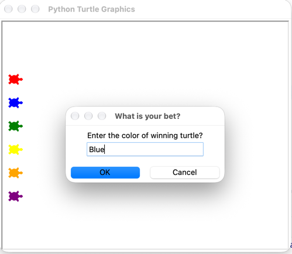

# Day 19 — Turtle Race & Keyboard Control

Two mini-projects from Day 19 of the 100 Days of Code challenge.

## Preview



## Projects

### `keyboard_instructions.py` — Keyboard-Controlled Turtle
Draw freely using keyboard controls.

| Key | Action |
|---|---|
| `W` | Move forward |
| `S` | Move backward |
| `A` | Turn left |
| `D` | Turn right |
| `C` | Clear and return home |

```bash
python keyboard_instructions.py
```

### `main.py` — Turtle Race
Bet on a colour, then watch six turtles race across the screen. Prints whether you guessed the winner correctly.

```bash
python main.py
```

## Concepts Practiced

- `Screen.onkey()` event binding
- Multiple turtle instances
- Randomness and simulation
- Basic user input with `Screen.textinput()`
