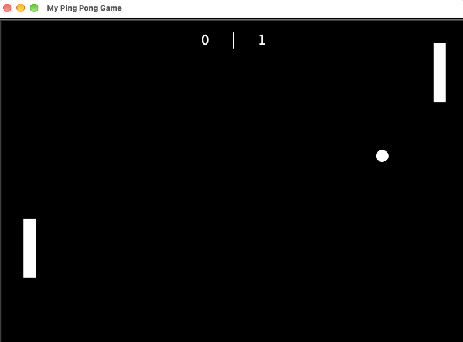

# Pong

A two-player Pong game built with Python's Turtle graphics library.

## Preview



## How to Play

| Player | Move Up | Move Down |
|---|---|---|
| Right (Player 1) | `↑` Arrow | `↓` Arrow |
| Left (Player 2) | `W` | `S` |

The ball speeds up each time it hits a paddle. First player to miss a point loses that round — scores are tracked on screen.

## How to Run

```bash
python keyboard_instructions.py
```

## Project Structure

| File | Responsibility |
|---|---|
| `main.py` | Game loop, screen setup, collision detection |
| `ball.py` | Ball movement, bouncing, speed |
| `paddle.py` | Paddle creation and movement |
| `scoreboard.py` | Score tracking and display |

## Concepts Practiced

- Object-Oriented Programming with inheritance (`Turtle` subclasses)
- Collision detection
- Game loop with `tracer(0)` / `screen.update()`
- Keyboard event binding
