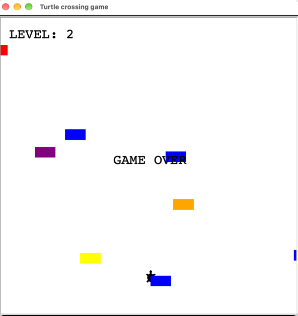

# Turtle Crossing

A Frogger-style crossing game built with Python's Turtle graphics library. Guide your turtle across the screen while avoiding oncoming cars. Each successful crossing raises the level and increases car speed.

## Preview



## Controls

| Key | Action |
|---|---|
| `↑` | Move up |
| `↓` | Move down |
| `←` | Move left |
| `→` | Move right |

## How to Run

```bash
python keyboard_instructions.py
```

## Project Structure

| File | Responsibility |
|---|---|
| `main.py` | Game loop, collision detection, level progression |
| `player.py` | Player (turtle) movement and reset |
| `car_manager.py` | Car spawning, movement, and speed scaling |
| `scoreboard.py` | Level display and game-over screen |

## Concepts Practiced

- Object-Oriented Programming with `Turtle` subclasses
- Random car spawning with probability
- Collision detection
- Level-based difficulty scaling
