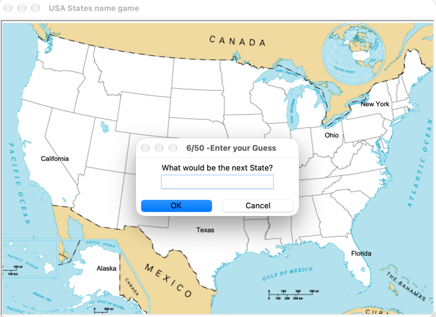

# Day 25 — US States Guess Game

## Preview



## Project

### `main.py` — US States Quiz
An interactive geography game — guess all 50 US state names. Correct guesses are plotted on a map. Type `Exit` to stop and save a list of states you missed to `remaining.csv`.

```bash
python main.py
```

**Data files:** `50_states.csv`, `blank_states_img.gif`

---

### `extras/` — Pandas Practice
Scratch files from the Pandas data analysis exercises (squirrel census, weather data).

## Requirements

```bash
pip install pandas
```

## Concepts Practiced

- Reading and filtering CSV files with pandas
- `DataFrame.to_csv()` for export
- List comprehensions with pandas Series
- Turtle graphics with custom background images
