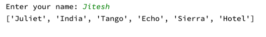

# Day 26 — NATO Phonetic Alphabet Converter

## Preview



## Project

### `main.py` — NATO Phonetic Alphabet Converter
Enter any word and get the NATO phonetic alphabet equivalent for each letter.

```
Enter your name: Jitesh
['Juliet', 'India', 'Tango', 'Echo', 'Sierra', 'Hotel']
```

```bash
python main.py
```

**Data file:** `nato_phonetic_alphabet.csv`

---

### `extras/` — Comprehension Practice
Scratch files from list and dictionary comprehension exercises (weather data, file comparisons).

## Requirements

```bash
pip install pandas
```

## Concepts Practiced

- List comprehensions
- Dictionary comprehensions
- Reading CSV files into a dictionary with pandas
- `.upper()` and string iteration
