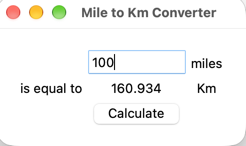

# Day 27 — Mile to Km Converter

## Preview



## Project

### `main.py` — Miles to Km Converter
Enter a distance in miles, click **Calculate**, and the result in kilometres is displayed instantly.

```bash
python main.py
```

---

### `extras/` — Tkinter Practice
Scratch files from the introductory Tkinter exercises (basic widgets, `*args` practice).

## Concepts Practiced

- Tkinter widgets: `Label`, `Button`, `Entry`
- `.grid()` layout manager
- `window.config(padx, pady)` for padding
- Real-time unit conversion with `float()` input parsing
