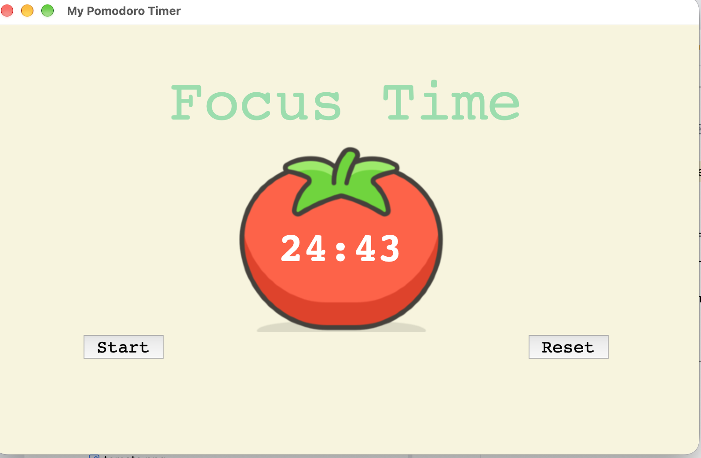

# Day 28 - Pomodoro Timer GUI

A desktop Pomodoro timer built with Python and Tkinter, featuring a tomato-themed interface.



## Features

- 25-minute focus sessions
- 5-minute short breaks after each session
- 20-minute long break after every 4 sessions
- Checkmarks track completed focus sessions
- Start and Reset controls

## How It Works

The timer cycles automatically through work and break intervals:

1. **Focus Time** (25 min) — green label
2. **Short Break** (5 min) — pink label
3. After 4 focus sessions → **Long Break** (20 min) — red label

A checkmark (⍻) appears below the timer after each completed focus session. Clicking Reset clears everything and returns to the initial state.

## Tech Used

- Python 3
- Tkinter (Canvas, Label, Button, after-scheduling)

## How to Run

```bash
python keyboard_instructions.py
```

> Make sure `tomato.png` is in the same directory as `main.py`.
