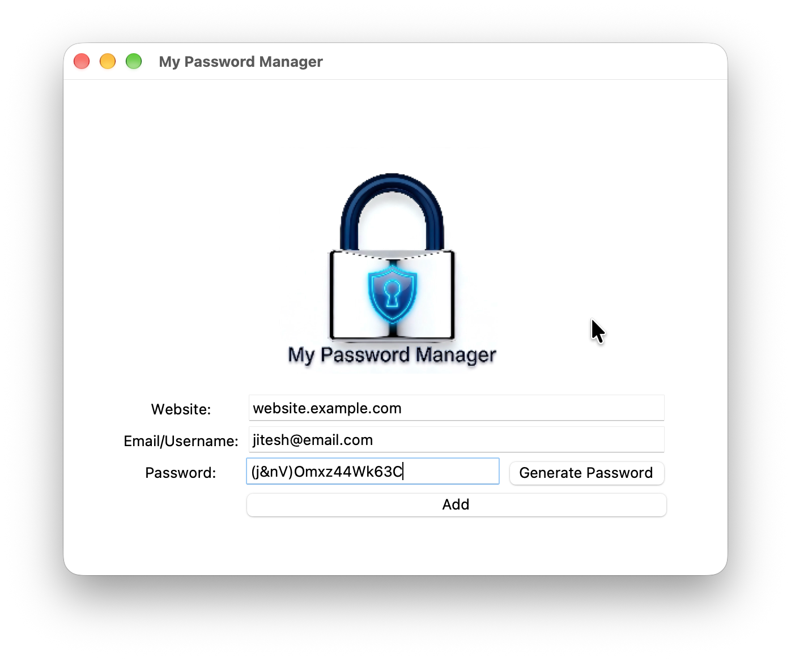

# Day 29 — Password Manager GUI

## Preview



## Project

A Tkinter-based password manager. Enter a website and email, generate a secure random password with one click, and save the credentials to a local file.

## Features

- Generates strong random passwords (letters, numbers, symbols)
- Auto-copies the generated password to clipboard
- Saves website, email, and password to `data.txt`

## How to Run

```bash
python main.py
```

## Concepts Practiced

- Tkinter GUI layout with `.grid()`
- Random password generation with `random` module
- File I/O for storing credentials
- `pyperclip` for clipboard access
